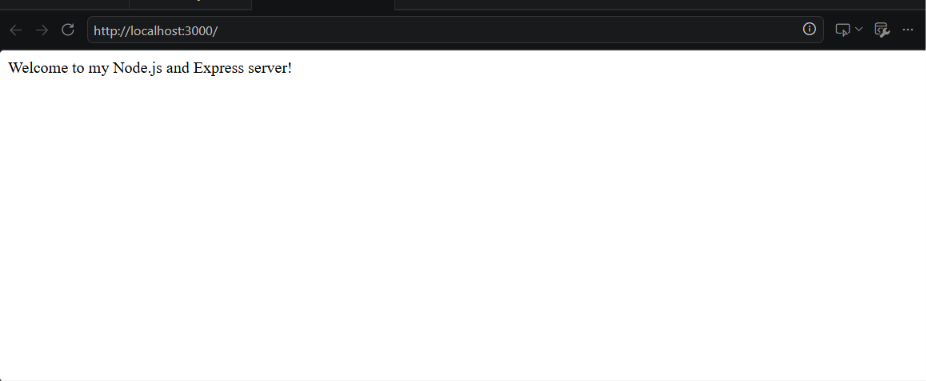
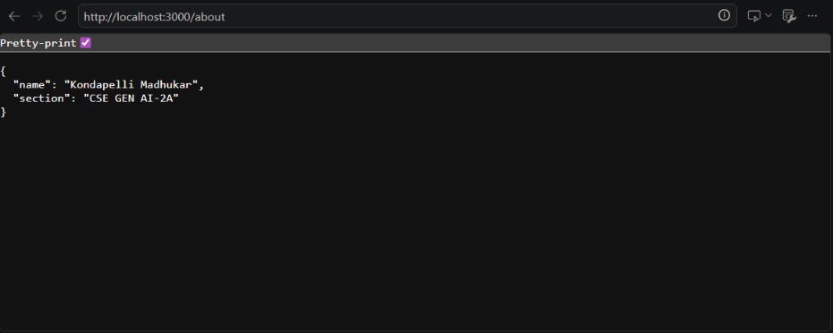
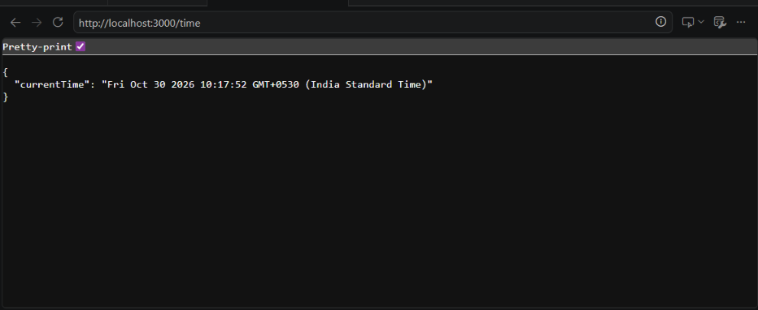
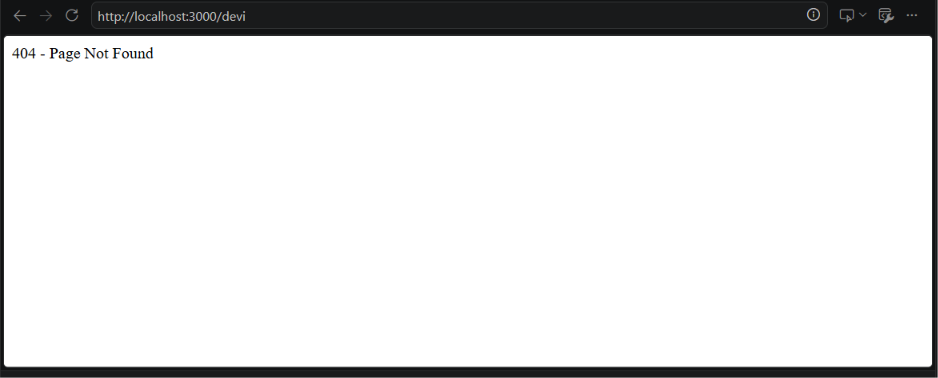

# Lab 1: Node.js and Express Server

## Student Details
- Name: Kondapelli Madhukar
- Registration Number: YOUR_REGISTRATION_NUMBER
- Section: YOUR_SECTION

## Live Link
https://backend-lab-reports-y5wc.onrender.com

## Objective
To create a web server using Node.js and Express.js and implement GET routes with appropriate HTTP status codes.

## How to Run
1. Install Node.js.
2. Open a terminal in this folder.
3. Install dependencies:

   ```bash
   npm install
   ```

4. Start the server:

   ```bash
   npm start
   ```

5. Open `http://localhost:3000` in your browser.

## Endpoints

| Method | Path | Description |
|---|---|---|
| GET | `/` | Displays a welcome message |
| GET | `/about` | Returns student details as JSON |
| GET | `/time` | Returns the current date and time |
| GET | Any unknown path | Returns a 404 message |

All three required routes return HTTP `200 OK`. Unknown paths return HTTP `404 Not Found`.

## Screenshots

Capture your own screenshots after running the server and save them using these filenames:

### Welcome Route


### About Route


### Time Route


### 404 Route


## Notes
- Replace `YOUR_REGISTRATION_NUMBER` and `YOUR_SECTION` with your actual details.
- The screenshots folder is included as a placeholder; add real screenshots of the working endpoints before submission.
- Deploy the app to Render, Railway, or another suitable platform and replace the Live Link above with the public URL.
- `node_modules` and `.env` must not be committed.
