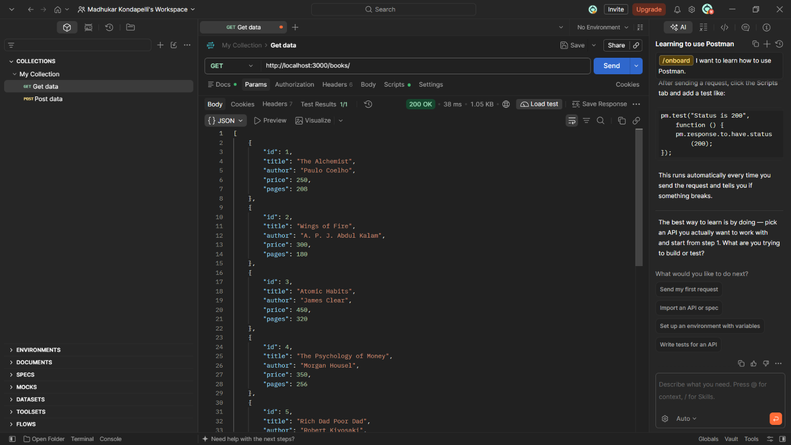
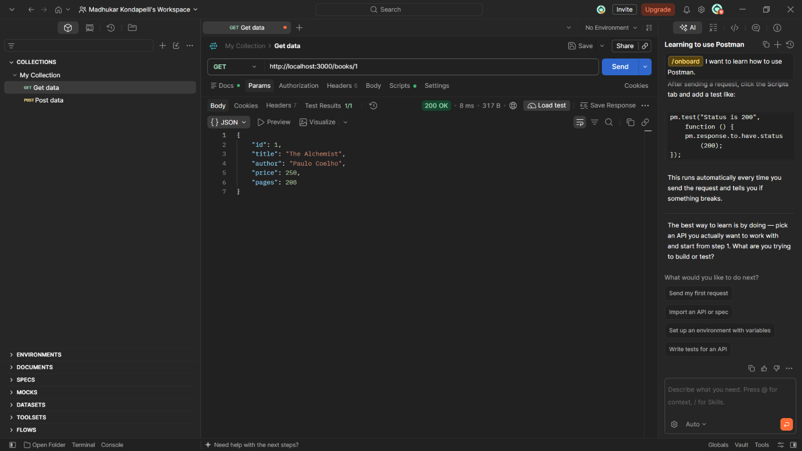
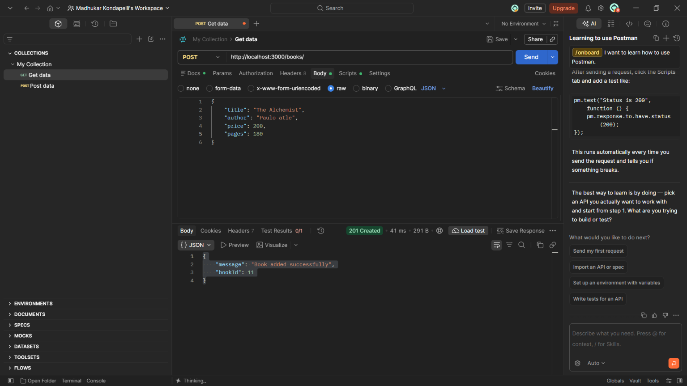
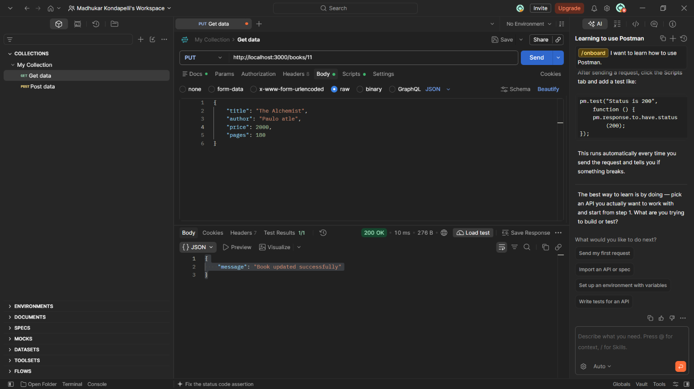
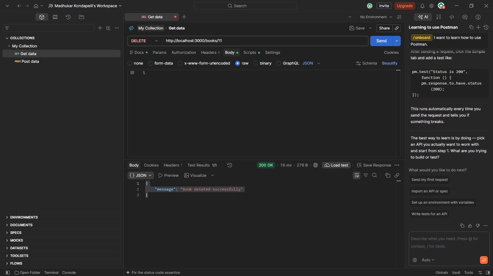
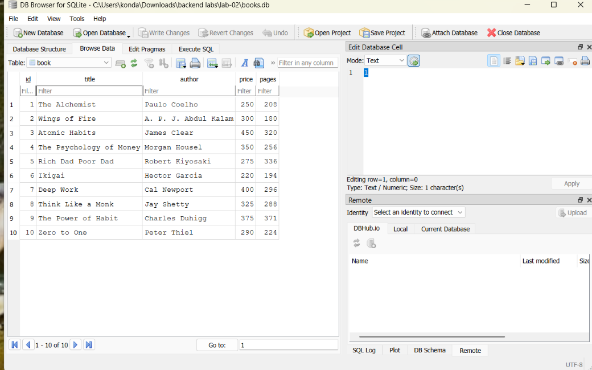

# Lab 2: SQLite database and CRUD routes

## Student Details
- Name: Kondapelli Madhukar
- Registration Number: 252U1R9071
- Section: CSE GEN-AI 2A 304 

## Live Link
https://backend-lab-reports-2.onrender.com

## Objective
Connect an Express server to a SQLite database and expose CRUD operations over HTTP.

## Project Files
- `server.js` — Express server and CRUD routes
- `books.db` — SQLite database with a `book` table and 10 sample rows
- `package.json` — dependencies and scripts
- `screenshots/` — add your Postman and database screenshots

## How to Run
1. Install Node.js.
2. Open a terminal in this folder.
3. Install dependencies: `npm install`
4. Run with nodemon: `npm run dev`
5. Or run normally: `npm start`
6. Open `http://localhost:3000`.

No environment variables are required locally. `PORT` is optional; the default is `3000`.

## Endpoints

| Method | Path | Description |
|---|---|---|
| GET | `/books/` | Returns all books |
| GET | `/books/:bookId/` | Returns one book by ID |
| POST | `/books/` | Adds a book |
| PUT | `/books/:bookId/` | Updates a book |
| DELETE | `/books/:bookId/` | Deletes a book |

## Postman JSON examples

POST `/books/` (Body → raw → JSON):
```json
{
  "title": "Learning Node.js",
  "author": "Example Author",
  "price": 400,
  "pages": 250
}
```

PUT `/books/1/` (Body → raw → JSON):
```json
{
  "title": "Updated Book",
  "author": "Updated Author",
  "price": 500,
  "pages": 300
}
```

Check `GET /books/` after POST, PUT, and DELETE to verify database changes.

## Screenshots
Add your real Postman screenshots and database view using these filenames:








## Notes
- The database connection is awaited before the server starts.
- User input is passed through `?` placeholders and parameter arrays.
- Replace the registration number and section placeholders.
- Add actual screenshots after testing all five endpoints.
- Do not commit `node_modules` or `.env`.
